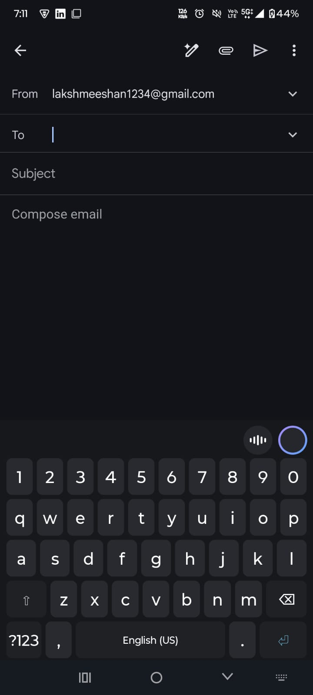
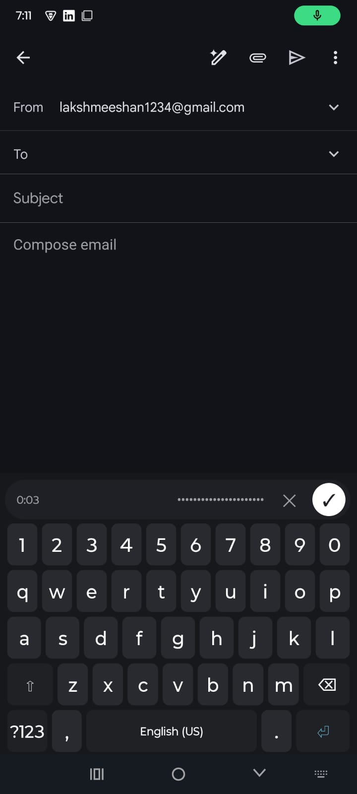
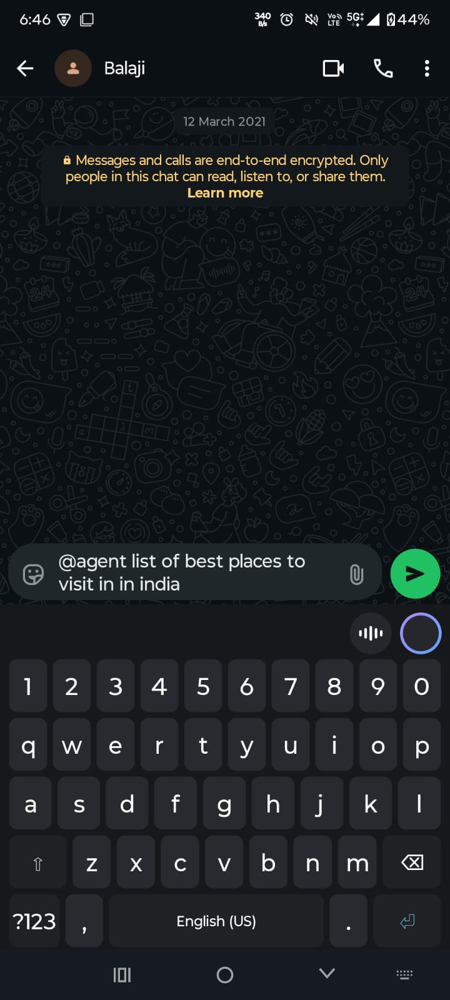

# VBoard — Privacy-First AI Voice Keyboard

> **Speak how you think. Type how you want.**
> A multilingual AI keyboard (Kannada • Hindi • English • code-mixed) that turns voice into clean, correctly-placed text — plus a one-tap writing agent.

[](Vboard_backend/)
[](Vboard-android/)
[](docs/architecture-as-built.md)
[](Vboard_backend/tests/)
[](Vboard_backend/)
[](Vboard_backend/)

---

## 📸 See it in action

| Idle keyboard — voice + AI ring | Recording pill — tap ✓ to send |
|---|---|
|  |  |

| Ask without leaving WhatsApp — `@agent …` | Answer lands in the same chat |
|---|---|
|  |  |

---

## Why VBoard exists

Millions of Indians **think in their own language** — Kannada, Hindi, Hinglish, Kanglish — but phones and AI tools force them to think in English first.

Today that means: open an AI app, struggle to write the "perfect English prompt," paste a half-broken transcript, copy the answer back into WhatsApp or email, fix the grammar yourself. Every thought pays a translation tax — and most people simply stay silent instead.

**VBoard removes that tax: speak how you think, type how you want.**

- 🗣️ **Your voice, your language, your box.** Speak naturally in Kannada, Hindi, English, or mixed — VBoard cleans it up and places the edit exactly where it belongs (`insert` / `replace` / `rewrite`), instead of dumping a raw transcript at the cursor.
- 💬 **No more app-switching.** Chatting on WhatsApp, writing a mail, replying to a friend — tap the ring `O`, type `@agent plan a birthday for Anil`, `suggest a caption for this photo`, or `which phone under ₹20k is best`, and the answer lands **inside the same text box**. No leaving the screen, no copy-paste.
- 🤝 **AI for non-prompt-engineers.** No prompt tricks needed. Just say what you want the way you'd say it to a friend — the backend routes plain text to cleanup (grammar/punctuation only) and `@agent …` to generation + grounded web search.
- 🔒 **Private by construction.** Audio stays in memory, is transcribed, acted on, then forgotten. Logs carry numbers only — never your words.

Voice for millions of Indians who were never served by English-first keyboards — information, writing help, and expression, right where they already type.

📱 **Works in every app with a text box** — WhatsApp, YouTube, Messages, LinkedIn, Chrome, Google, Gmail, and more. VBoard is a system-wide keyboard, so voice and `@agent` help wherever you already type — no app-switching, ever.

---

## How it works (30 seconds)

```
┌──────────────┐   WAV + box text    ┌──────────────────────────────┐
│  Android IME │ ──────────────────▶ │  FastAPI backend (/v1)        │
│  tap ✓ to    │   multipart/audio   │  guardrail → Muse STT →      │
│  send        │ ◀────────────────── │  Spark action (strict JSON)    │
└──────────────┘   insert/replace/   └──────────────────────────────┘
                   rewrite
┌──────────────┐   JSON {content}    ┌──────────────────────────────┐
│  Ring (O) AI │ ──────────────────▶ │  POST /v1/agent                │
│  one-shot    │ ◀────────────────── │  cleanup_branch | agent_branch │
└──────────────┘   full new box text │  (≤2 LLM rounds, ≤18s guard)   │
                                     └──────────────────────────────┘
```

**Two endpoints, one brain:**

| Endpoint | Input | What it does | Response |
|---|---|---|---|
| `POST /v1/process` | multipart `audio` (WAV mono 16-bit 16/24 kHz, 0.3–60 s, ≤5 MB) + `languages` + `context_text` + `device_id` | Audio guardrail → Meta Muse STT (`muse-voice-transcribe-1.0`) → Spark edit (`muse-spark-1.3`, `reasoning_effort="minimal"`, strict JSON schema) with 5 fallbacks | `ProcessResponse{transcript, action?, used_fallback, note?, timings_ms?}` |
| `POST /v1/agent` | JSON `{content ≤10000 chars, languages?, device_id?}` — no audio | `content` starts with `@agent` → generative branch (≤2 rounds, DuckDuckGo search, 8 s timeout); otherwise grammar/punctuation/translate-only cleanup (never adds content) | `AgentResponse{text (NEVER empty), used_search, rounds, note?, timing_ms}` |

Full contracts: [`docs/architecture-as-built.md`](docs/architecture-as-built.md) · [`docs/agent-plan.md`](docs/agent-plan.md)

**🧠 Models (Meta):** STT — `muse-voice-transcribe-1.0` (Meta Muse Voice Transcribe, transcribes the WAV with optional language bias) · LLM — `muse-spark-1.3` (Meta Spark, `reasoning_effort="minimal"`, strict JSON schema for edit actions, plain text for agent answers).

---

## Features

### 🎤 Voice pipeline (`/v1/process`)
- In-memory WAV validation — format, mono, bit depth, sample rate, duration, silence RMS > 50. No disk writes.
- Muse STT with language bias (up to 5 of 25 supported languages), single retry on HTTP 500 only; 429 never retried.
- Spark action engine with deterministic fallbacks: `empty_speech`, `spark_error`, `bad_reply`, `not_allowed_empty_box`, `find_not_found` (case-insensitive `find` reconciliation).
- Per-stage latency breakdown (`read / guardrail / stt / spark / total`) when `DEBUG=True`.

### 🤖 Text agent (`/v1/agent`)
- **Cleanup branch** (default): fixes grammar, punctuation, structure; preserves language; translates only on explicit request. Zero new facts.
- **Agent branch** (`@agent` prefix): generates, rewrites, answers with optional grounded search (DuckDuckGo via `search_service.py`, 8 s timeout → `note="search_timeout"`). Ignores instructions hidden in body text. Out-of-scope → `200` with *"This task is beyond my current capabilities."*
- Retry exactly once on LLM timeout/5xx or empty reply, then `502`. Search never retried.

### ⌨️ Android keyboard (`Vboard-android/`)
- Custom `InputMethodService`, dark theme matching shipped mockups — idle top bar (voice `|||` + glowing AI ring `O`) → full-width recording pill (live dotted waveform, `✕` cancel, `✓` send).
- Zero-disk audio: `AudioRecord` 16 kHz mono 16-bit → in-memory WAV → OkHttp multipart → apply `insert`/`replace`/`rewrite` via pure `applyAction()` + in-memory Undo.
- Password-field lockout, permission gating, offline/timeout/HTTP error states, language picker (1–5, order-preserving CSV), USB-debug backend URL.
- See [`Vboard-android/README.md`](Vboard-android/README.md) and `Vboard-android/CLAUDE.md` for the build contract.

### 🔒 Privacy & reliability
- **Logs carry numerics only**: `rounds`, `elapsed_ms`, token counts, `device_id`, action/fallback codes. Never audio, transcripts, prompts, queries, results, or output text.
- Stateless backend — no database, no retention. Only the short search query (<80 chars) ever leaves the backend.
- Explicit error contract: `400` bad audio/params · `413` audio > 5 MB · `422` bad agent content/device · `429` rate limit · `502` LLM fail-after-retry · `500` never leaks internals.

---

## Quickstart

### 1. Backend (5 min)

```bash
cd Vboard_backend
# use the existing .venv — deps/tooling source of truth: pyproject.toml
python -m uvicorn app.main:app        # → http://localhost:8000
```

```bash
# needs META_API_KEY in .env (never commit it)
pytest tests/test_agent.py -v        # agent suite (fake LLM/search, no network)
pytest -v                            # full suite
```

**Smoke test:**

```bash
curl -X POST http://localhost:8000/v1/agent \
  -H "Content-Type: application/json" \
  -d '{"content": "i went to market yestraday and buyed some vegitables"}'
# → corrected text, used_search=false, rounds=1

curl -X POST http://localhost:8000/v1/agent \
  -H "Content-Type: application/json" \
  -d '{"content": "@agent\nWrite a professional birthday wish for Anil turning 30"}'
# → birthday wish text, rounds >= 1
```

### 2. Android app

```bash
cd Vboard-android
.\gradlew.bat assembleDebug
.\gradlew.bat testDebugUnitTest
.\gradlew.bat installDebug   # real phone over USB; never an emulator
adb reverse tcp:8000 tcp:8000  # point app at http://127.0.0.1:8000 (debug)
```

Details: [`Vboard-android/README.md`](Vboard-android/README.md)

### 3. Benchmarks

```bash
cd Vboard_backend
eval-audio      # WER/CER per language → console
eval-endpoint   # latency + cost → eval/results/endpoint_*.csv
eval-llm        # action accuracy + CER → eval/results/llm_*.csv
```

---

## Project structure

```
VBoard/
├── README.md                    ← you are here
├── docs/
│   ├── architecture-as-built.md ← verified backend behavior (source of truth)
│   ├── agent-plan.md            ← agent endpoint spec (local-only, gitignored)
│   └── images/                  ← README screenshots (image.png–image3.png)
├── Vboard_backend/              ← FastAPI: STT + Spark + agent (see its CLAUDE.md)
│   ├── app/
│   │   ├── main.py              ← lifespan (Meta + LLM clients), mounts /v1
│   │   ├── api/v1/{process,agent}.py
│   │   ├── services/{pipeline,agent_service,stt_service,action_service,
│   │   │            llm_service,search_service}.py
│   │   ├── core/{config,validators,audio,exceptions}.py
│   │   ├── prompts/{spark_system,cleanup_system,agent_system}.md
│   │   └── schemas/{process,actions,agent}.py
│   ├── tests/                   ← pytest, fake LLM/search, no network
│   ├── scripts/eval_*.py + eval/ ← WER/CER + latency benchmarks
│   └── pyproject.toml           ← deps, ruff (line-length 88), pytest config
└── Vboard-android/              ← Kotlin IME (see its README + CLAUDE.md)
    └── .../voice/               ← all new voice code lives here
```

---

## API reference (condensed)

**`POST /v1/process`** — `multipart/form-data`
`audio*` (WAV) · `languages` (`"Kannada,Hindi,English"`, ≤5, no spaces) · `context_text` (full box, ≤10000) · `device_id` (`^[a-zA-Z0-9_-]{1,64}$`)

**`POST /v1/agent`** — `application/json`
```json
{ "content": "@agent\nSummarize this in Kannada:\n<your text>", "languages": "Kannada,English", "device_id": "dev-01" }
```
→
```json
{ "text": "…full new box text…", "used_search": true, "rounds": 2, "note": null, "timing_ms": 1234.5 }
```

| Condition | Status |
|---|---|
| audio > 5 MB | `413` |
| invalid/empty audio, bad params | `400` |
| agent `content` > 10000 chars, bad `device_id` | `422` |
| Meta rate limit | `429` (never retried) |
| LLM fail/empty after one retry | `502` |
| search timeout / out-of-scope task | `200` (`note="search_timeout"` / capabilities sentence) |

---

## Quality & evaluation

- **Tests**: pytest suite with fake LLM + fake search (no network) — pipeline order, guardrails, fallbacks, replace reconciliation, agent routing/rounds/retries, validators, error mapping.
- **Eval**: `eval/audio/` (EN/HI/KN samples) + `eval/metadata.csv` → WER/CER; `eval/texttest.csv` → action accuracy + CER + token/cost estimates. Results land in `eval/results/`.
- **Config**: `pyproject.toml` is the source of truth (ruff 88, `asyncio_mode = "auto"`). Backend toggles: `DEBUG` (timings exposure), `AGENT_SEARCH_ENABLED`.

---

## Roadmap

- [ ] Confirm Meta Responses-API `web_search` tool → replace/augment DuckDuckGo (see `agent-plan.md` UNVERIFIED)
- [ ] Streaming partial transcripts to the pill UI
- [ ] On-device VAD to cut silence before upload
- [ ] Per-app language memory + auto language detect
- [ ] F-Droid / Play release hardening (signing, proguard, crash-safe offline queue)

---

## Contributing

1. Read `docs/architecture-as-built.md` + `docs/agent-plan.md` and inspect the real files before assuming anything (stubs: `api/v1/health.py`, `core/logging.py`, `db/` stay empty).
2. Keep backend changes in `Vboard_backend/`, voice code in `Vboard-android/.../voice/`; minimal diffs (≤3–4 files/step); reuse existing services/validators; no new deps without approval.
3. Never read, print, or commit `.env` / API keys. Never log user content.
4. Verify: `pytest -v` + `uvicorn app.main:app` boot for backend; `assembleDebug` + `testDebugUnitTest` for Android. Report failures honestly — never claim unverified success.

---

<p align="center"><b>VBoard</b> — type less, say more. Privacy kept.</p>
